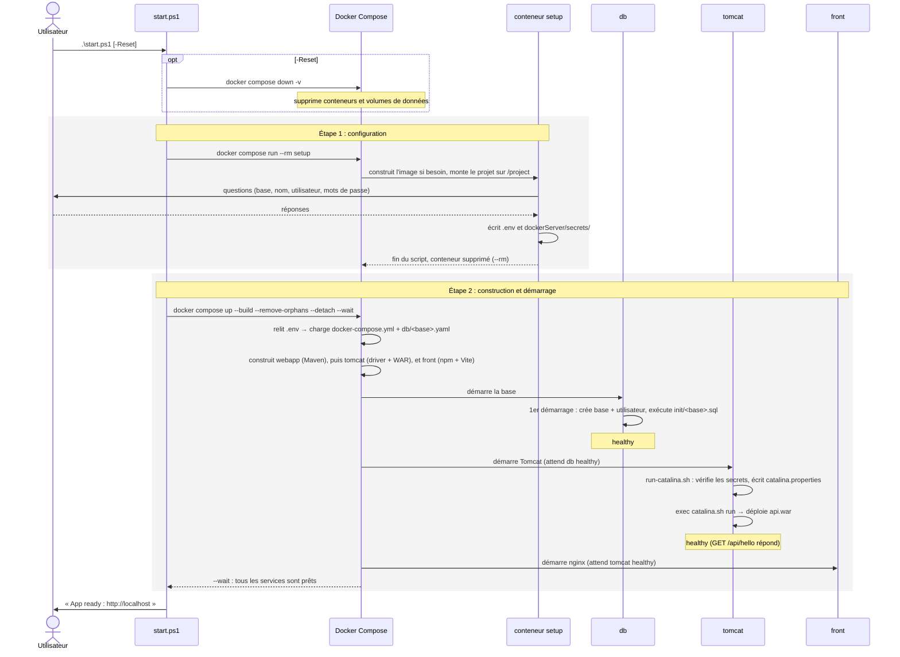
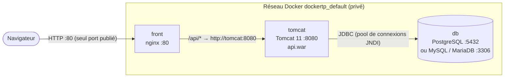
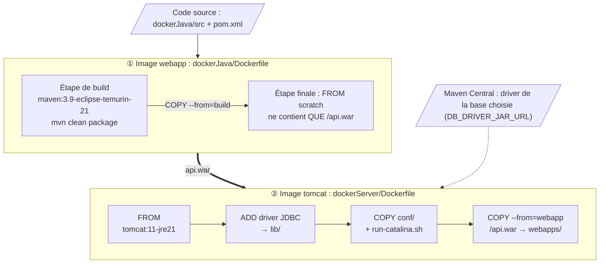
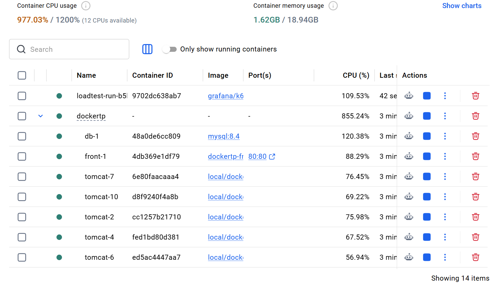
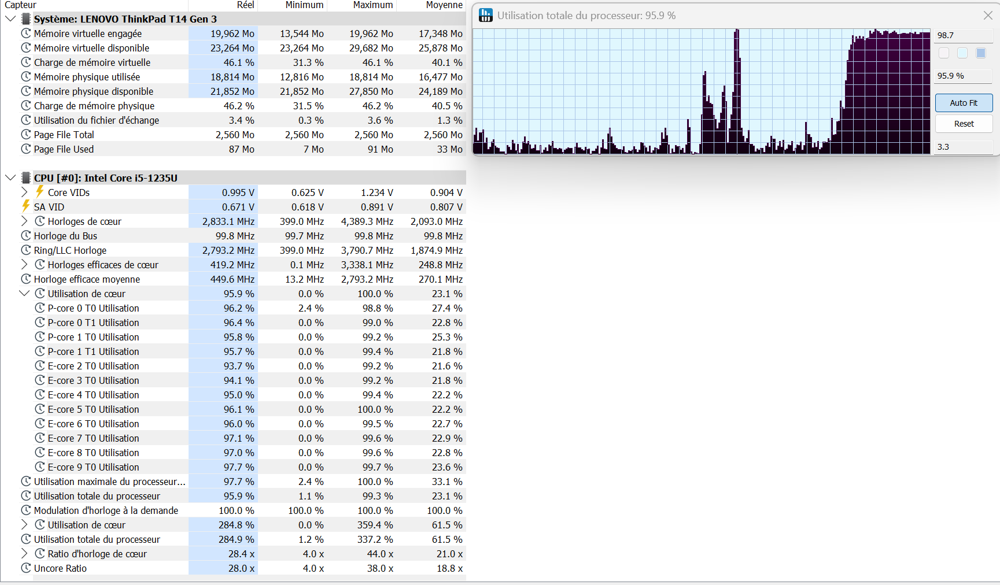
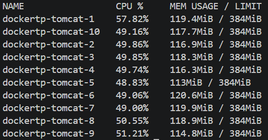

# TPdocker : boilerplate Tomcat conteneurisé

Application web complète conteneurisée avec Docker Compose, le but étant de proposer un template, 
afin de limiter le code boilerplate a effectuer lors de la creation d'une application centrée sur un .war. L'application démarre via un script qui initialisera un tomcat servant l'application java et une base de donnée sera initailisée via les choix de l'utilisateur, un front-end en React sera lui aussi crée lors du lancement du script :

- un **front React** (Vite) servi par **nginx** ;
- une **API Java** (servlets Jakarta) packagée en WAR et déployée dans **Tomcat 11** ;
- une **base de données au choix** : PostgreSQL, MySQL ou MariaDB, sélectionnée par un assistant de configuration.

---

## Sommaire

1. [Démarrage rapide](#1-démarrage-rapide)
2. [Architecture et schéma des communications](#2-architecture-et-schéma-des-communications)
3. [Les images](#3-les-images)
4. [Orchestration](#4-orchestration)
5. [Commandes utiles et dépannage](#6-commandes-utiles-et-dépannage)

---

## 1. Démarrage rapide

Prérequis : Docker Desktop (ou Docker Engine) avec Docker Compose v2.

```powershell
# Windows : configuration + construction + démarrage en une commande
.\start.ps1            # ajouter -Reset pour effacer les données des bases
```

Ou étape par étape (Windows, Linux, macOS) :

```bash
docker compose run --rm setup     # 1. choisir la base, générer .env et les mots de passe
docker compose up --build         # 2. construire les images et démarrer
```

| URL | Résultat attendu |
|---|---|
| http://localhost | le front React |
| http://localhost/api/hello | `{"message":"Hello World!"}` |
| http://localhost/api/messages | le contenu de la table `message`, lu en base |

> Si le port 80 est déjà pris, ajouter `FRONT_PORT=8080` dans le `.env`.

### Ce qui se passe pendant le lancement

`start.ps1` enchaîne deux commandes Docker Compose l'une après l'autre. C'est à cause du fait que Compose lit le `.env` au début de chaque commande, et le `.env` n'est crée que suite au premier lancement du docker-compose.



**Étape 1 : `docker compose run --rm setup`**
1. Si le script est lancé avec l'argument '-reset', on va dans un premier temps supprimer les volumes existant si l'utilisateur souhaite repartir à 0.
2. Compose construit l'image setup à partir de setup/Dockerfile si elle n'existe pas encore. L'image ne contient que Node et le script (setup.mjs, databases.json).
3. Compose lance un conteneur à partir de cette image. On exécute le script dans un conteneur, on lui dit d’écrire dans /project, et le compose fait de /project une porte d’accès vers le dossier local du projet.
4. Le script setup.mjs pose ses questions. Si un .env existe déjà, il demande d'abord s'il faut le remplacer : répondre « n » garde la configuration actuelle et passe directement à l'étape 2. Il faut, au moment de la selection de la base de donnée, taper les chiffres correspondants aux choix donnés, (1 pour postgre...ect).
5. Il écrit les fichiers suivants dans le projet :

| Fichier | Contenu |
|---|---|
| `.env` | `COMPOSE_FILE` (socle + fragment de la base choisie), `DB_NAME`, `DB_USER`, `NB_REPLICAS` |
| `dockerServer/secrets/db-password` | Mot de passe de l'utilisateur de la base (aléatoire) |
| `dockerServer/secrets/manager-password` | Mot de passe du compte de `tomcat-users.xml` (aléatoire) |
| `dockerServer/secrets/db-root-password` | Mot de passe root, uniquement pour MySQL et MariaDB (aléatoire) |

4. Le conteneur s'arrête et `--rm` le supprime : il ne reste que les fichiers écrits.

**Étape 2 : `docker compose up --build --remove-orphans --detach --wait`**

1. **Lecture de la configuration.** Compose relit le .env écrit par le setup pour savoir quelle base a été choisie, puis assemble le socle commun (docker-compose.yml et dockerServer/docker-compose.yml) et le fichier de la BDD choisie, afin d’obtenir une seule configuration complète.
2. **Construction des images** (`--build`). `webapp` est construite avant `tomcat`, qui en a besoin. `front` est construite en parallèle. Grâce au cache, seules les étapes dont les fichiers ont changé sont refaites.
3. **Création du réseau et des volumes** (`dockertp_default`, `pgdata`…), s'ils n'existent pas encore.
4. **Démarrage dans l'ordre imposé par les `depends_on`** :
   - **`db`** démarre. Au tout premier lancement, quand le volume est vide, l'image crée la base et l'utilisateur à partir du `.env` et du fichier de mot de passe, puis exécute `init/<base>.sql`. Elle devient `healthy` quand son healthcheck répond.
   - **`tomcat`** démarre seulement ensuite. `run-catalina.sh` vérifie la présence des mots de passe, écrit les propriétés de connexion dans `catalina.properties`, puis passe la main à Tomcat (`exec`), qui déploie `api.war`. Il devient `healthy` quand `/api/hello` répond.
   - **`front`** démarre en dernier : nginx sert le front et relaie les routes `/api/*` vers Tomcat.
5. **Nettoyage** (`--remove-orphans`). Si la base a changé depuis le dernier lancement, le conteneur de l'ancienne base est supprimé. Son volume de données est conservé.
6. **Attente** (`--wait`). La commande ne rend la main que lorsque tous les services sont prêts. `--detach` les laisse tourner en arrière-plan.

Si une étape échoue (build, healthcheck…), le script affiche les 50 dernières lignes de logs et s'arrête avec le code d'erreur de Docker.

---

## 2. Architecture et schéma des communications


### Comment le code Java arrive dans Tomcat

La compilation du Java et l'exécution dans Tomcat sont séparées en **deux images**. Le service `webapp` ne lance jamais de conteneur (`replicas: 0`) : il sert uniquement à fabriquer une image qui contient le WAR, et l'image `tomcat` copie ce WAR pendant sa propre construction.



Dans le Dockerfile de Tomcat, `COPY --from=webapp` désigne l'image construite par le service `webapp`. C'est la ligne `additional_contexts: webapp: service:webapp` du compose qui fait ce lien, et qui oblige Compose à construire `webapp` **avant** `tomcat`. J'avais au debut utilisé "depends on", mais cette commande ne marachait pas car depend_on va attendre qu'un conteneur tourne alors que le but du service webapp est justement de "s'eteindre" après complétion. De plus, "additional_context" donne accés à la production d'un autre service, ici lui permettant de recupérer les .war produit dans webapp.

---

## 3. Les images

Le projet construit quatre images et utilise des images officielles pour les bases de données.

| Service | Dockerfile | Image de base | Rôle |
|---|---|---|---|
| `webapp` | `dockerJava/Dockerfile` | `maven:3.9-eclipse-temurin-21` puis `scratch` | Compiler le WAR (jamais lancé) |
| `tomcat` | `dockerServer/Dockerfile` | `tomcat:11-jre21` | Exécuter l'API |
| `front` | `dockerJs/Dockerfile` | `node:22-alpine` puis `nginx:stable-alpine` | Compiler et servir le front |
| `setup` | `setup/Dockerfile` | `node:22-alpine` | Assistant de configuration |
| `db` | aucun (image officielle) | `postgres:17-alpine`, `mysql:8.4` ou `mariadb:11.4` | Base de données |

Les images `webapp` et `front` sont construites en **plusieurs étapes** (*multi-stage build*) : les outils de compilation (Maven, Node) restent dans l'étape de build et n'arrivent jamais dans l'image finale. J'ai essayé de tirer parti de l'architecture en couche des fichiers dockerfile en placant les couches les plus susceptibles au changement en fin de fichier afin de ne pas trigger des actions qui n'auaraient pas étés modifiées. J'ai aussi essayé de tirer profit du cache de buildkit afin de limiter les actions effectués a chaque redémarrage.

`CMD` ou `ENTRYPOINT` : Les images du projet utilisent CMD : c’est la commande par défaut, qu’on peut remplacer facilement pour déboguer (docker compose run --rm tomcat bash). Aucune de nos images n’a besoin d’un programme fixe auquel on passerait des arguments, ce qui est le cas d’usage d’ENTRYPOINT. L’image nginx garde son propre ENTRYPOINT, qui prépare la configuration avant de lancer sa CMD. Toutes les commandes sont écrites sous forme de tableau JSON (["node", "setup.mjs"]) : le programme est lancé directement, sans shell intermédiaire, et devient le PID 1 qui reçoit les signaux d’arrêt.

## 4. Orchestration

### 4.1 Gestion des SIGTERM

À l'arrêt (`docker compose stop`, `down`, ou un redémarrage), Docker envoie un signal **au PID 1** du conteneur, puis le tue de force (SIGKILL) au bout de 10 secondes s'il est toujours là. Un arrêt propre suppose donc que le vrai programme soit le PID 1 et qu'il réagisse au signal.

| Service | PID 1 | Signal reçu | Durée d'arrêt mesurée | Ce que montrent les logs |
|---|---|---|---|---|
| `tomcat` | `java` | SIGTERM | **0,44 s** | `Pausing` → `Stopping service [Catalina]` → `Destroying ProtocolHandler` |
| `front` | `nginx: master process` | SIGQUIT (`STOPSIGNAL` de l'image) | **0,42 s** | les processus nginx se terminent avec le code 0, puis `exit` |
| `db` (PostgreSQL) | `postgres` | SIGINT (`STOPSIGNAL` de l'image) | **0,31 s** | `received fast shutdown request` → `database system is shut down` |
| `setup` | `tini`, puis `node` | SIGTERM, SIGINT (Ctrl+C) | **0,2 s** (10,2 s sans `init`) | — |

- **`tomcat`** : grâce aux deux `exec` (dans `run-catalina.sh`, puis dans `catalina.sh`), Java est le PID 1 et déclenche sa procédure d'arrêt propre. Le code de sortie **143** (128 + 15, « arrêté par SIGTERM ») est normal. Un code **137** signalerait au contraire un arrêt forcé (SIGKILL).
- **`front` et `db`** : les images officielles déclarent elles-mêmes le signal adapté à leur arrêt propre. MySQL et MariaDB gèrent SIGTERM nativement.
- **`setup`** : Node n'est pas conçu pour tourner en PID 1. Linux ignore alors les signaux pour lesquels il n'a rien prévu, et un Ctrl+C restait sans effet. **`init: true`** place en PID 1 un mini-processus (`tini`) qui transmet les signaux à Node.

### 4.2 Lint

Trois services vérifient la qualité du code. Comme `setup`, ils ont le profil `lint` : `docker compose up` les ignore, et on les lance à la demande.

| Service | Outil | Vérifie |
|---|---|---|
| `lint-dockerfiles` | hadolint (`hadolint/hadolint`) | les 4 Dockerfiles |
| `lint-shell` | shellcheck (`koalaman/shellcheck`) | `run-catalina.sh` |
| `lint-front` | ESLint (`npm run lint`) | le code React, via l'étape `lint` de `dockerJs/Dockerfile` |

```bash
docker compose run --rm lint-dockerfiles
docker compose run --rm lint-shell
docker compose run --rm --build lint-front
```

- Chaque outil tourne dans son image officielle : rien à installer sur la machine.
- Le projet est monté en **lecture seule** (`.:/src:ro`) : le lint ne peut rien modifier.
- Chaque commande renvoie un code d'erreur si un problème est trouvé : elles peuvent donc être enchaînées dans un script ou une intégration continue.
- Deux règles de hadolint sont des faux positifs, ignorés et justifiés : `DL3020` (le `ADD` télécharge une URL, ce que `COPY` ne sait pas faire ; commentaire dans le Dockerfile) et `DL3022` (`COPY --from=webapp` vise un contexte fourni par le compose ; fichier `.hadolint.yaml`).

### 4.3 Scaling de Tomcat

Le setup demande le **nombre d'instances Tomcat** (de 1 à 10). La réponse est écrite dans le `.env` (`TOMCAT_REPLICAS`), puis utilisée par le compose :

```yaml
  tomcat:
    deploy:
      replicas: ${TOMCAT_REPLICAS:-1}   # 1 par défaut si la variable est absente du .env
```

**Pourquoi Docker Compose suffit, sans Swarm.** Sur une seule machine, Compose sait lancer plusieurs conteneurs d'un même service. Trois éléments le permettent :

- **Pas de `container_name` ni de port publié sur `tomcat`.** Compose nomme lui-même les conteneurs (`dockertp-tomcat-1`, `-2`…), et aucun ne réserve de port sur la machine hôte.
- **Le DNS de Docker** renvoie l'adresse de toutes les instances pour le nom `tomcat`.
- **nginx répartit les requêtes** entre ces adresses (`server tomcat:8080 resolve;` dans l'`upstream`), et retire automatiquement une instance qui ne répond plus.

**Résultats mesurés avec 3 instances** : 60 requêtes simultanées se répartissent en **6 / 6 / 6** connexions, et avec une instance arrêtée, **20 requêtes sur 20** réussissent.

### 4.4 Ressources  

Meme avec 10 Tomcats lancés, la consomation reste raisonable, même sous traffic soutenu, grâce a la légèreté des tomcats (test lancés via `docker compose run --rm loadtest`) :



Stress test via grafana avec 10 tomcats lancés, on voit ici les limitation de ma machine au niveau du processseur mais pas au niveau de la mémoire :



Les différents tomcats, eux se repartissent bien la charge de manière égale :



### 4.5 Limitation des ressources

| Conteneur | Limite | Justification |
|---|---|---|
| `front` (nginx) | **64 Mo** | nginx ne sert que des fichiers statiques et relaie des requêtes : il consomme quelques Mo. 64 Mo laissent une marge confortable. |
| `tomcat` | **768 Mo, 1 CPU** | Une JVM a besoin d'espace pour ses objets (*heap*), mais aussi pour le code compilé, les threads et le reste de la JVM. 1 CPU permet à Tomcat de démarrer bien avant les 60 s du `start_period` du healthcheck : avec moins, le démarrage ralentit fortement. |
| `tomcat` (JVM) | **`-XX:MaxRAMPercentage=75`** | La JVM lit la limite du conteneur et s'accorde 75 % pour le *heap* (environ 576 Mo). Les 25 % restants servent au reste de la JVM. Sans cette option, la JVM ne prendrait que 25 % de la mémoire par défaut. Sans limite dans le compose, le pourcentage s'appliquerait à toute la mémoire de la machine. |
| `db` (les 3 bases) | **512 Mo** | Suffisant pour une petite base de développement. MySQL et MariaDB sont les plus gourmands au démarrage. |
| `webapp` | aucune | Jamais lancé (`replicas: 0`) |
| `setup` | aucune | Ne vit que quelques secondes, le temps des questions |

- Les limites sont déclarées avec `deploy.resources.limits`, appliqué par `docker compose` même hors Docker Swarm.
- Chaque limite est définie **dans le fichier qui déclare le service** : `front` à la racine, `tomcat` dans `dockerServer/`, `db` dans chaque fragment `db/<base>.yaml`.
- Un conteneur qui dépasse sa limite mémoire est tué par Docker (code 137, `OOMKilled`), puis relancé par `restart: unless-stopped`. `docker stats` permet de suivre la consommation réelle.


**Limites :**

- **Seul `tomcat` est multipliable** : `front` publie le port 80, qu'un seul conteneur peut occuper, et `db` ne se duplique pas sans mettre en place une réplication.
- **Sessions HTTP** : chaque Tomcat garde ses sessions en mémoire. L'API actuelle n'en utilise pas. Si c'était le cas, il faudrait des sessions persistantes dans nginx, un stockage partagé (Redis) ou une API sans état (jeton JWT).
- **Swarm ou Kubernetes** ne deviennent utiles que pour répartir sur **plusieurs machines** ou mettre à jour sans interruption.

### 4.4 Pourquoi pas swarm ?

Il aurait fallu rajouter une surcouche swarm qui aurait lancée les différents conteneurs préparés par le docker compose en amont, et qui auraient étés push sur mon regstry perso, c'est la prochaine étape mais je n'ai malheureusement pas reussi à le setup avant la fin du rendu...

---

## 5. Commandes utiles et dépannage

| Commande | Usage |
|---|---|
| `docker compose ps` | état et santé des conteneurs |
| `docker compose logs -f tomcat` | logs en direct d'un service |
| `docker compose config` | configuration finale après fusion des fichiers |
| `docker stats` | consommation mémoire et CPU |
| `docker compose exec db psql -U app -d app` | console SQL (PostgreSQL) |
| `docker compose down` | arrêt (les données sont conservées) |
| `docker compose down -v` | arrêt **et suppression des données** |

| Symptôme | Cause et solution |
|---|---|
| `No database yet configured` au build | Le setup n'a pas été lancé : `docker compose run --rm setup` |
| Tomcat `unhealthy`, connexion à la base refusée | Un ancien volume contient une base créée avec d'autres identifiants : `docker compose down -v`, puis relancer |
| `bash: -: invalid option` dans les logs de Tomcat | Fins de ligne Windows dans un script `.sh` : corrigées automatiquement par le `sed` du Dockerfile, reconstruire l'image |
| Port 80 déjà utilisé | Ajouter `FRONT_PORT=8080` dans le `.env` |
